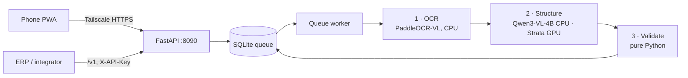

<div align="center">

# 🧾 Okur

**Local-first receipt OCR: a worker photographs a receipt, your own PC returns verified JSON.**

*Okur means "reader" in Turkish. The model reads the receipt; code checks the numbers.*


</div>

> **🇹🇷 Türkçe özet:** Okur, saha çalışanının telefonla çektiği market / akaryakıt / restoran fişini tek bir
> bilgisayarda, buluta hiçbir şey göndermeden yapılandırılmış JSON'a çeviren bir sistemdir. Telefon tarafı kurulabilir
> bir PWA; PC tarafı üç aşamalı bir hat: PaddleOCR-VL fişi okur, küçük bir Qwen3-VL-4B (CPU) ya da Strata (GPU) metni
> sözleşme v1 alanlarına döker, saf Python doğrulayıcı satır toplamlarını, ara toplamı, KDV'yi (karışık oranlı fişte
> oran oran) ve genel toplamı **yeniden hesaplar**. Model hiçbir sayının sahibi değildir: tutmayan fiş `mismatch`
> olarak işaretlenir, yeniden hesaplanamayan tutar (ör. fiş geneli iskonto) `unverified` listesinde açıkça belirtilir.
> Fiş görselleri kişisel veridir (KVKK) ve makineden çıkmaz. Kurulum: [HIZLI-BASLANGIC.md](HIZLI-BASLANGIC.md).

## What it is

- **Three stages on one PC, no cloud.** Stage 1 OCR (PaddleOCR-VL 1.6), stage 2 structuring into contract v1
  (Qwen3-VL-4B on CPU by default, Strata on GPU as an option), stage 3 a pure-Python validator.
- **The model never owns a number.** The validator recomputes line totals, ara toplam, KDV and genel toplam from the
  items and compares them with what was printed. The verdict is `ok`, `mismatch` (naming the exact fields) or
  `unreadable`; amounts nothing on the receipt lets it recompute are listed in `unverified`, never passed off as checked.
- **Built for a field team.** Installable phone PWA (camera → crop → send → live stages → history), one revocable API
  key per worker, an admin panel for review, corrections and JSON/CSV/XLSX export, and a frozen `/v1` API for an ERP
  push (Logo Netsis via NetOpenX).



## Results

**Synthetic fixtures** (6 receipts: fuel, market, restaurant; clean scan and phone photo each). PASS = schema + totals
within 0.01 + item count + validator `ok` ([details](spike/SMALL_BRAIN_BAKEOFF.md)):

| Stage 2 | Hardware | PASS | s / receipt |
|---|---|---:|---:|
| Strata, Qwen3.8-Flash-Next (~80B MoE) | GPU | 5 / 6 | 6.5 |
| **Qwen3-VL-4B IQ4_XS, image + OCR text** (default) | CPU, 0 VRAM | **5 / 6** | 30.6 |
| Qwen3-VL-4B IQ4_XS, OCR text only | CPU | 5 / 6 | 22.5 |
| Qwen3-4B-Instruct-2507 IQ4_XS, text only | CPU | 5 / 6 | 15.8 |
| Qwen3-VL-2B IQ4_XS, image + OCR text | CPU | 4 / 6 | 21.6 |

**Real receipts** (3, kept off the repo), full stack:

| Receipt | Strata | Small brain |
|---|---|---|
| Clean thermal market receipt | `ok` | `mismatch`: split 9 items into 10; the validator caught it |
| BİM, angled, wrinkled | `mismatch` | `mismatch` |
| Handwritten list | `unreadable` | `unreadable` |

**Limits, stated plainly:** synthetic parity overstated real parity. On real receipts the 4B segments line items
worse than the 80B, and three real receipts are not an evaluation. Next: 20+ real receipts with field-level accuracy
before the small brain is trusted as the default.

## Quickstart

Windows 11, PowerShell, Python 3.12 + [uv](https://docs.astral.sh/uv/). Every env name and failure mode is in the
[reference](docs/REFERENCE.md#quickstart).

```powershell
uv venv .venv --python 3.12
.\scripts\install_small_brain.ps1              # stage 2 model, sha256-checked
.venv/Scripts/python -m app.keys_cli add ayse  # a worker key, printed once
.venv/Scripts/python run.py                    # OCR + stage 2 + app + worker
.\scripts\tailscale_serve.ps1                  # phones: HTTPS on the tailnet only
```

No models yet? `.venv/Scripts/python scripts/serve_demo.py` runs the real app, queue and validator against stub model
servers. Tests: `pytest` (Python) and `node --test tests/js/*.test.js`; the launcher tests expect the model files.

## Safety rules the code enforces

1. Receipt images and the database stay under `data/` (gitignored); no cloud call anywhere in the pipeline; EXIF is
   stripped on upload.
2. The app listens on loopback; Tailscale `serve` is the only door, `funnel` is never used.
3. Every total is recomputed; a disagreement is a `mismatch`, never a silent fix.
4. Worker keys are stored hashed and shown once; a revoked key answers `401` on the next call.
5. With `ADMIN_TOKEN` unset there is no admin login at all; secrets live only in `.env`.
6. `/v1` never breaks: fields are added, never renamed or removed.

## How it was built

Design, contract, validation rules and evaluation are mine. Implementation ran through the
[MERGEN](https://github.com/mahmuterenakkaymak/mergen) hybrid pipeline: a cloud model planned and reviewed each
milestone, a local Qwen model wrote each task and its tests, and a deterministic orchestrator ran the acceptance
checks (8 milestones, 110+ tasks). The process notes are in [PLAN.md](PLAN.md) and [spike/](spike/).

## Docs

[Reference manual](docs/REFERENCE.md) · [Turkish quick start](HIZLI-BASLANGIC.md) · [Operations](OPERATIONS.md) ·
[Contract v1](CONTRACT.md) · [Project brief](PROJECT_BRIEF.md)

## Built on

[PaddleOCR-VL](https://github.com/PaddlePaddle/PaddleOCR) (Apache 2.0) · [llama.cpp](https://github.com/ggml-org/llama.cpp)
(MIT) · [Qwen3-VL](https://huggingface.co/Qwen) (Apache 2.0) · [Strata](https://github.com/Niko1221/Strata) (MIT) ·
[FastAPI](https://fastapi.tiangolo.com) · [Pydantic](https://docs.pydantic.dev) · [openpyxl](https://openpyxl.readthedocs.io)
· [Pillow](https://python-pillow.org) · [Tailscale](https://tailscale.com). No model is redistributed here; check each
model's license before a commercial deployment.

## License

[MIT](LICENSE) © 2026 Mahmut Eren Akkaymak.
