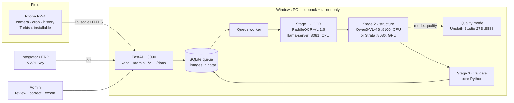
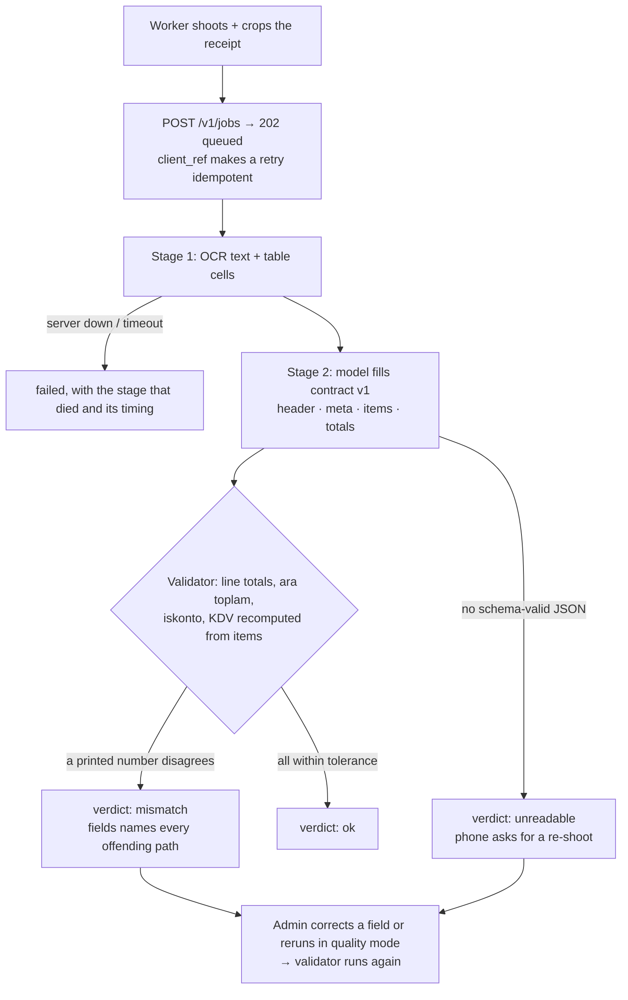

<div align="center">

# 🧾 Okur

**Local-first receipt OCR: a worker photographs a receipt, your own PC returns verified JSON.**

*Okur means "reader" in Turkish — and "it reads". It reads the receipt; the numbers are checked by code.*


</div>

> **🇹🇷 Türkçe özet:** Okur, saha çalışanının telefonla çektiği market / akaryakıt / restoran fişini tek bir
> bilgisayarda, buluta hiçbir şey göndermeden yapılandırılmış JSON'a çeviren bir sistemdir. Telefon tarafı kurulabilir
> bir PWA (kamera → kırp/döndür → gönder → canlı aşamalar → geçmiş); PC tarafı üç aşamalı bir hat: PaddleOCR-VL fişi
> okur, küçük bir Qwen3-VL-4B (CPU, sıfır VRAM) ya da Strata metni sözleşme v1 alanlarına döker, saf Python
> doğrulayıcı her satır toplamını, ara toplamı, iskontoyu ve KDV'yi **yeniden hesaplar** — model hiçbir sayının sahibi
> değildir; tutmayan fiş `mismatch` olarak işaretlenir, gizlenmez. Entegratörler için dondurulmuş bir `/v1` API'si,
> yönetici için inceleme / düzeltme / JSON-CSV-XLSX dışa aktarım paneli vardır. Fiş görselleri kişisel veridir (KVKK):
> `data/` altında kalır, makineden çıkmaz; erişim yalnızca Tailscale üzerinden. Kurulum ve günlük kullanım, Türkçe:
> [HIZLI-BASLANGIC.md](HIZLI-BASLANGIC.md).

---

## What it is

- **A receipt reader that lives on your PC.** The worker opens the Okur app on their phone, shoots the receipt,
  crops it and sends it. Seconds of OCR later, a ~30–45 s structuring pass on a CPU-only box (seconds on a GPU)
  returns the shop, date, line items, totals and KDV as one frozen JSON envelope.
- **Numbers you can trust.** The model reads and structures; it never owns a number. A pure-Python validator
  recomputes every line total, ara toplam, iskonto and KDV from the items and compares them with what was printed.
  The verdict is `ok`, `mismatch` (naming the exact fields) or `unreadable` — a mismatch is shown, never forced.
- **CPU-only out of the box.** Stage 1 (PaddleOCR-VL 1.6) and stage 2 (Qwen3-VL-4B, 2.1 GB) both run on the CPU with
  zero VRAM — it fits a customer's office PC. Strata on the GPU is an optional upgrade behind one env line, and
  quality mode routes a hard receipt to a 27B in Unsloth Studio.
- **A contract integrators can build on.** `/v1` is frozen: fields are added, never renamed or removed. Idempotent
  `client_ref`, per-key rate limits, one error shape, a JSON Schema and a live OpenAPI UI generated from the same
  models — the shape an ERP push (Logo Netsis via NetOpenX) can rely on.
- **Built for a field team.** One API key per worker, revocable the day a phone is lost; an admin panel for review,
  corrections (which re-run the validator), exports and live status; a phone app that never loses a photo when the
  network or the key fails.
- **Honest about itself.** Every stage reports its own timing; gates against real receipts fail loudly when quality
  drops — including the small brain's own regression on real receipts ([Results](#results)).

## What you need

| | |
|---|---|
| **PC** | Windows 11, any modern CPU, **~4 GB free RAM** for both models, ~6 GB disk. **No GPU needed.** |
| **Optional GPU** | for Strata as stage 2 (Qwen3.8-Flash-Next on an RTX 5090 32 GB in the tested setup) or Unsloth Studio for quality mode |
| **Software** | Python 3.12 + [uv](https://docs.astral.sh/uv/), the llama.cpp `llama-server` binary, the PaddleOCR-VL 1.6 GGUF ([OPERATIONS.md](OPERATIONS.md) → Model paths) |
| **Phones** | Android (Chrome) or iOS (Safari) with [Tailscale](https://tailscale.com) — the tailnet is the only way in |

## Install

### Let your AI set it up

Using an AI coding assistant (Claude Code, Cursor, Codex, GitHub Copilot, ...)? Paste this into it:

```text
Set up Okur on this PC for me: https://github.com/mahmuterenakkaymak/Okur — follow the Quickstart in its README, run the demo and the test suite before connecting real models, and ask me before anything that downloads models or exposes a port beyond the tailnet.
```

### Or do it yourself

PowerShell, from the repository root. The full walk-through, with every env name, is in [Quickstart](#quickstart).

```powershell
# 1. Python env (the venv has no pip of its own)
uv venv .venv --python 3.12
# 2. stage 2, once: Qwen3-VL-4B + vision projector, sha256-checked
.\scripts\install_small_brain.ps1
# 3. a key for the first worker, printed exactly once
.venv/Scripts/python -m app.keys_cli add ayse
# 4. start OCR + stage 2 + app + queue worker; the admin UI opens when everything is green
.venv/Scripts/python run.py
# 5. phones: HTTPS on the tailnet only
.\scripts\tailscale_serve.ps1
```

No models yet? `.venv/Scripts/python scripts/serve_demo.py` runs the real app, auth, queue and validator against stub
model servers, seeded with the committed synthetic fixtures.

## Architecture



Everything binds to `127.0.0.1`; Tailscale's `serve` is the only door from a phone, and `funnel` is never used. There
are no cloud calls in the pipeline at all.

## How a receipt is read



The loop around the models is plain Python: the queue, retries, timeouts, the schema, the arithmetic and the verdict
are code. The models are the reading layer.

## Results

**Synthetic fixtures** (6 receipts: fuel, market, restaurant; clean scan and phone photo each), stage 2 bake-off,
PASS = schema + totals within 0.01 + item count + validator `ok` ([details](spike/SMALL_BRAIN_BAKEOFF.md)):

| Stage 2 | Hardware | PASS | s / receipt |
|---|---|---:|---:|
| Strata, Qwen3.8-Flash-Next (~80B MoE) | GPU | 5 / 6 | 6.5 |
| **Qwen3-VL-4B IQ4_XS, image + OCR text** (default) | CPU, 0 VRAM | **5 / 6** | 30.6 |
| Qwen3-VL-4B IQ4_XS, OCR text only | CPU | 5 / 6 | 22.5 |
| Qwen3-4B-Instruct-2507 IQ4_XS, text only | CPU | 5 / 6 | 15.8 |
| Qwen3-VL-2B IQ4_XS, image + OCR text | CPU | 4 / 6 | 21.6 |

The one miss is the same photographed fuel receipt for every model — a quality-mode case, not a small-model gap.

**Real receipts** (3, kept off the repo: a market receipt, a wrinkled BİM receipt shot at an angle, a handwritten
list), full stack, live OCR gate:

| Receipt | Strata baseline | Small brain |
|---|---|---|
| Clean thermal market receipt | `ok` | `mismatch` — split 9 items into 10; totals identical, the validator caught it |
| BİM, angled, wrinkled | `mismatch` (savings row) | `mismatch` |
| Handwritten list | `unreadable` | `unreadable` |

- **Synthetic parity overstated real parity.** On real receipts the 4B segments line items worse than the 80B. The
  failure is item counting, not transcription — and the validator flagged it instead of passing a wrong total. Next:
  few-shot line-item prompting and 8–10 more real receipts before the small brain is trusted as the default.
- **Stage 1 is the easy part.** PaddleOCR-VL reads real receipts in 5–7 s on the CPU with clean table output.
- **The first live run found what 679 unit tests could not:** Strata is a reasoning model and spent its whole token
  budget thinking, returning `content: null`. Fixed with `enable_thinking: false` ([report](spike/CANLI_TEST_RAPORU.md),
  Turkish).

**Tested setup**

| Part | Version / value |
|---|---|
| OS | Windows 11 Pro 26200 |
| Hardware | Ryzen 9 9950X3D · 96 GB DDR5 · RTX 5090 32 GB (only for the Strata / quality arms) |
| Stage 1 | PaddleOCR-VL 1.6 GGUF + mmproj, llama.cpp `llama-server`, CPU (`OCR_NGL=0`) |
| Stage 2 | Qwen3-VL-4B-Instruct IQ4_XS + F16 mmproj, llama.cpp CPU · Strata, Qwen3.8-Flash-Next UD-IQ4_XS |
| Python / Node | 3.12 (uv) / 24 for the JS tests |
| Tests | 1,026 Python + 235 JavaScript, all green |

## Daily use

| | |
|---|---|
| **`run.py`** | starts OCR, stage 2, the app and the queue worker; prints a roll-call (OCR ✓ · Small brain ✓ · Uygulama ✓) and opens the admin UI; `--stop` takes it all down |
| **Phone app** (`/app`) | camera → crop/rotate → send → live stages → history; result card with totals and the verdict; offline shell |
| **Admin** (`/admin`) | job list with filters, detail with stage timings, field corrections, quality-mode rerun, JSON/CSV/XLSX export, worker keys, live status |
| **Integrators** (`/v1`, `/docs`) | `POST /v1/jobs`, poll `GET /v1/jobs/{id}`; OpenAPI UI with try-it-out |
| **`app.keys_cli`** | `add <name>`, `list`, `revoke <id>` for worker keys |
| **Gates** | `pytest`, `scripts/smoke_e2e.py`, `scripts/acceptance.py --demo`, and the real-receipt gates `scripts/live_ocr_gate.py` / `scripts/small_brain_gate.py` |

## Safety rules the code enforces

1. **Receipts never leave the PC** — images and the database live under `data/`, which is gitignored; no cloud OCR
   or LLM anywhere in the path; EXIF is stripped on upload.
2. **No public internet** — the app listens on loopback; Tailscale `serve` is the only ingress, `funnel` is never
   run, no router port is forwarded.
3. **The model never owns a number** — every total is recomputed by the validator; a disagreement is a `mismatch`
   with the offending fields, never a silent fix.
4. **One key per worker** — keys are stored hashed and shown once; revoking one answers `401` on the next call.
5. **The admin panel has no default door** — with `ADMIN_TOKEN` unset there is no admin login at all.
6. **Secrets in `.env` only** — gitignored, never logged, never committed.
7. **v1 never breaks** — a breaking change opens `/v2` and leaves `/v1` answering.

## Repository

| Path | |
|---|---|
| [`app/`](app/) | FastAPI app, routes, queue worker, pipeline, OCR client, structurer, validator, contract, keys, config |
| [`static/app/`](static/app/) | the phone PWA (Turkish) and its service worker |
| [`static/admin/`](static/admin/) | the admin panel |
| [`contract/`](contract/) · [`CONTRACT.md`](CONTRACT.md) | contract v1 JSON Schema and the integrator contract |
| [`run.py`](run.py) | the launcher and its roll-call |
| [`scripts/`](scripts/) | small-brain installer, Tailscale, demo, smoke, acceptance and real-receipt gates |
| [`fixtures/`](fixtures/) · [`fixtures_hard/`](fixtures_hard/) | synthetic receipts with their expected JSON (real receipts stay local) |
| [`tests/`](tests/) | 1,026 Python tests; 235 JS tests via `node --test tests/js/*.test.js` |
| [`spike/`](spike/) | the model bake-offs and the live test reports behind the decisions |
| docs | [quick start, Turkish](HIZLI-BASLANGIC.md) · [operations](OPERATIONS.md) · [plan](PLAN.md) · [brief](PROJECT_BRIEF.md) |

Built with the [MERGEN](https://github.com/mahmuterenakkaymak/mergen) hybrid pipeline: a cloud model wrote the plan
and reviewed each milestone, a local Qwen model wrote every task and its tests, and a deterministic orchestrator ran
the acceptance checks. 8 milestones, 110+ tasks.

## Built on

[PaddleOCR-VL](https://github.com/PaddlePaddle/PaddleOCR) (Apache 2.0) · [llama.cpp](https://github.com/ggml-org/llama.cpp)
(MIT) · [Qwen3-VL](https://huggingface.co/Qwen) by the Qwen team (Apache 2.0), GGUF by Unsloth ·
[Strata](https://github.com/Niko1221/Strata) (MIT) · [FastAPI](https://fastapi.tiangolo.com) (MIT) ·
[Pydantic](https://docs.pydantic.dev) (MIT) · [openpyxl](https://openpyxl.readthedocs.io) (MIT) ·
[Pillow](https://python-pillow.org) (MIT-CMU) · [Tailscale](https://tailscale.com). None of them is redistributed here;
check each model's license before a commercial deployment.

## License

[MIT](LICENSE) © 2026 Mahmut Eren Akkaymak. The models are not part of this repository and keep their own
licenses (PaddleOCR-VL and Qwen3-VL: Apache 2.0).

---

# Reference

The operator and integrator manual: every command, env name and failure mode. This text is also a test contract —
`tests/test_docs.py` and `tests/test_tailscale.py` hold it to the code.

## What it is — the three stages

One machine, no cloud. The phone PWA posts a photo to FastAPI on `:8090`; a queue
worker runs three stages and answers with one frozen JSON envelope:

1. **OCR** — PaddleOCR-VL-1.6 through llama.cpp `llama-server` on `:8081`,
   on CPU by default (`OCR_NGL=0`), so it never competes with Strata for VRAM.
2. **Structuring** — the stage-2 brain turns the raw text into contract v1
   `result`: the small brain by default — Qwen3-VL-4B on CPU, `:8100`, zero VRAM —
   or Strata on `:8080`, whichever `STRUCTURER_BACKEND` names; `mode: "quality"`
   routes the same job to Unsloth Studio on `:8888`. `meta.model` says which one
   answered.
3. **Validation** — pure Python (`app/validator.py`) recomputes every line total,
   ara toplam, iskonto and KDV from `items[]` and compares them with what the
   model claimed. The LLM never owns a number: `validation.verdict` is `ok`,
   `mismatch` (with the offending dotted paths in `fields`) or `unreadable`.

| Door | What is behind it |
| --- | --- |
| `/app` | worker PWA — camera → crop/rotate → submit → live stages → history (Turkish, installable) |
| `/admin` | review, corrections, JSON/CSV/XLSX exports, worker keys, live status |
| `/v1/*` | the frozen integrator API (contract v1, `X-API-Key`) |
| `/docs` | OpenAPI UI — the same schemas, with try-it-out |

Receipt images and the SQLite database live under `data/`, which is gitignored:
they are personal data (KVKK) and never leave this machine. Backups, key
rotation, logs, model paths and VRAM are in [`OPERATIONS.md`](OPERATIONS.md).
Turkish quick start for Eren: [`HIZLI-BASLANGIC.md`](HIZLI-BASLANGIC.md).

## Quickstart

Windows, PowerShell, from the repository root. Python 3.12 and
[uv](https://docs.astral.sh/uv/) — the venv has no pip of its own.

```powershell
uv venv .venv --python 3.12
uv pip install --python .venv/Scripts/python.exe fastapi "uvicorn[standard]" httpx pydantic jsonschema openpyxl pillow python-dotenv python-multipart pytest
```

The stack is CPU-only out of the box: `STRUCTURER_BACKEND` defaults to `small`, so
stage 2 is the small brain on `127.0.0.1:8100` — no GPU, no CUDA, no second
machine. Install that brain first, once, before the first start (≈3.1 GB into
`%LOCALAPPDATA%\ocr-small-brain\`):

```powershell
.\scripts\install_small_brain.ps1          # downloads what is missing
.\scripts\install_small_brain.ps1 -Check   # what is installed, what is not
```

Strata is the optional upgrade behind that switch, never a requirement:
`STRUCTURER_BACKEND=strata` in `.env` plus a restart moves stage 2 to it — the
rollback, in one line ([`OPERATIONS.md`](OPERATIONS.md) → Small brain).

Then write `.env` at the root (gitignored; every name is read in `app/config.py`):

```env
ADMIN_TOKEN=pick-a-long-random-string
LLAMA_SERVER=vendor/llama/llama-server.exe
OCR_MODEL=models/paddleocr-vl-1.6/PaddleOCR-VL-1.6-GGUF.gguf
OCR_MMPROJ=models/paddleocr-vl-1.6/PaddleOCR-VL-1.6-GGUF-mmproj.gguf
OCR_CHAT_TEMPLATE=models/paddleocr-vl-1.6/chat_template.jinja
```

`ADMIN_TOKEN` has no default on purpose — with it unset the admin panel has no
door at all. The demo is the one exception: `scripts/serve_demo.py` pins
`ADMIN_TOKEN=demo` and prints it on its boot line, so `/admin` opens on a box
with no `.env`. Model and binary paths, defaults and where to get the files:
`OPERATIONS.md` → Model paths.

One key per worker, printed exactly once:

```powershell
.venv/Scripts/python -m app.keys_cli add ayse
```

Start everything — `llama-server`, the stage-2 brain, uvicorn and the queue worker —
and the admin UI opens itself once the roll-call is all green: every child on
`/health`, the stage-2 brain on its model listing (Strata, when it is stage 2,
runs outside this launcher):

```powershell
.venv/Scripts/python run.py
.venv/Scripts/python run.py --no-browser --app-port 8090 --ocr-port 8081
.venv/Scripts/python run.py --stop
```

No models downloaded yet? The demo runs the real app, auth, queue and validator
against stub model servers, seeded with the committed fixtures:

```powershell
.venv/Scripts/python scripts/serve_demo.py
```

Checks, smallest first:

```powershell
.venv/Scripts/python -m pytest -q
.venv/Scripts/python scripts/smoke_e2e.py
.venv/Scripts/python scripts/acceptance.py --demo
```

## Small brain — stage 2 on a CPU-only box

Stage 2 does not need a GPU or a second machine. A second `llama-server` on
`127.0.0.1:8100` serves Qwen3-VL-4B-Instruct (IQ4_XS, ≈2.1 GB) with its F16 vision
projector, on CPU, asking the card for nothing: stages 1 and 2 plus the app on one
box with ~4 GB free RAM. It is stage 2 out of the box — install it and start:

```powershell
.\scripts\install_small_brain.ps1          # downloads what is missing
.\scripts\install_small_brain.ps1 -Check   # what is installed, what is not
```

Files go to `%LOCALAPPDATA%\ocr-small-brain\` (`OCR_SMALL_BRAIN_DIR` moves them),
every download is checked against the `sha256` in `scripts\small_brain_manifest.json`,
and a stalled Hugging Face CDN falls back to `hf-mirror.com`. Nothing has to be
configured; this is what the default already says:

```env
STRUCTURER_BACKEND=small   # the default; =strata is the rollback
```

`python run.py` then starts the brain as its own child and waits on
`GET http://127.0.0.1:8100/v1/models`; that is also the hand check — a JSON model list
means stage 2 is alive, a refused connection means `data/logs/small-brain.log` says
why. Hardware numbers, a busy port 8100, the `SMALL_BRAIN_*` reference and the
cold-load `STARTUP_WAIT_S` note: [`OPERATIONS.md`](OPERATIONS.md) → Small brain.

## PWA install

The PWA is the worker's whole app; it installs from a real HTTPS origin, so
[Tailscale](#tailscale--https-on-the-tailnet) has to be up first (`http://localhost:8090/app`
works for local testing, but a browser will not offer to install it).

1. Open `https://<tailnet-host>.ts.net/app` in the phone's browser — Chrome on
   Android, Safari on iOS.
2. Install it: Android → the browser menu → **Uygulamayı yükle**; iOS → Share →
   **Ana Ekrana Ekle**. It launches standalone, in Turkish, as "Okur".
3. Paste the worker's own API key into **API anahtarı** (admin → Anahtarlar, or
   `python -m app.keys_cli add <name>`). Keys are shown once; the phone keeps it.
4. Allow the camera when asked. Where `getUserMedia` is unavailable the form
   falls back to `<input type=file capture>`, so the flow never dead-ends.
5. A deploy lands on the next cold start — the service worker only caches the
   app shell, never a receipt image.

Lost phone or a worker leaving: revoke the key (admin → Anahtarlar, or
`keys_cli revoke <id>`). Further calls answer 401 and the PWA stops on its
"API anahtarı çalışmıyor" card instead of losing the photo.

## Integrator guide

Two documents, one truth:

- [`CONTRACT.md`](CONTRACT.md) — the human contract: every field, the verdict
  rules, the versioning promise. `contract/contract_v1.schema.json` is the
  machine-readable form, generated from `app/contract.py`; regenerate both with
  `.venv/Scripts/python scripts/gen_contract_doc.py` in the same commit as the
  model change.
- `/docs` — the live OpenAPI UI of the running instance (schemas plus
  try-it-out, `X-API-Key` in the Authorize box). It is generated from the same
  pydantic models, so it cannot drift from the server answering you.

Every `/v1` call carries the key:

```bash
curl -s -X POST http://127.0.0.1:8090/v1/jobs \
  -H "X-API-Key: ocrk_..." \
  -F image=@fis.png \
  -F client_ref=sof-0007 \
  -F mode=fast
```

`POST /v1/jobs` answers **202** with the envelope and a `queued` status; the
work happens in the queue. Poll `GET /v1/jobs/{job_id}` until `status` is `done`
or `failed`, and read `result` (header, meta, items, totals) plus `validation`
(verdict, expected, actual, fields). `GET /v1/jobs?status=done&mine=true` lists
what this key has sent.

- **Idempotency.** `client_ref` is unique per key: a retry that reuses one
  answers **200** with the existing `job_id` and queues nothing. Omit it and you
  get a fresh job every time — so send a ref whenever a retry is possible.
- **Corrections are not yours to make.** Fixing a field, re-running a job in
  quality mode and exporting live under `/admin/api/*` behind the admin session,
  not under `/v1`.
- **Errors are one shape:** `{"error": {"code", "message", "details?"}}` —
  `unauthorized` (401, missing/revoked key), `rate_limited` (429 with
  `Retry-After`), `payload_too_large` (413, over `MAX_UPLOAD_MB`),
  `validation_error` (422, `details[]` names the field). A `202`/`200` envelope
  is never a verdict: only `validation.verdict` is.
- **v1 is frozen.** Fields are added, never renamed or removed; a breaking
  change opens `/v2` and leaves `/v1` answering.

## Tailscale — HTTPS on the tailnet

The app itself listens plain HTTP on `127.0.0.1:8090` (`APP_PORT`, see
`app/config.py`); TLS and its certificate are Tailscale's job. Start the stack
first (`python run.py`) — `tailscale serve` only proxies, it never launches the app.

```powershell
.\scripts\tailscale_serve.ps1              # enable HTTPS for the app port
.\scripts\tailscale_serve.ps1 -Status      # what tailscale serves right now
.\scripts\tailscale_serve.ps1 -Rollback    # take HTTPS back down
```

| | |
| --- | --- |
| Port | `8090` — the app port (`-AppPort` to override, `-HttpsPort` for the tailnet-side port, default `443`) |
| Cert path | `data\certs\` — the certificate and key the script exports with `tailscale cert`; `data/` is gitignored and the key is a secret, so never commit it |
| Rollback | `tailscale serve --https=443 off` (what `-Rollback` runs); the files under `data\certs\` stay on disk — deleting them is the operator's call |

Tailscale issues and renews the certificate for this machine's own
`<host>.<tailnet>.ts.net` name, so `run.py` needs no TLS flags and uvicorn keeps
listening on loopback.

### No public internet (v1 rule)

The tailnet is the only ingress (`PROJECT_BRIEF.md` §8): no public-internet
exposure in v1. Concretely — never run `tailscale funnel`, never forward a port on
the router, never point public DNS at this host. `funnel` is the one command that
would publish receipt images (personal data: names, card last-4) and the API to the
whole internet, which is why the script uses `serve` and never `funnel`. If
integrators or workers ever turn out to be external, a public HTTPS front-end is a
separate product decision — TLS, hardening and data policy included.

### Enrolling a worker's phone

1. Install Tailscale on the phone (App Store / Google Play) and sign in with the
   account that owns this tailnet.
2. Approve the new device in the Tailscale admin console if the tailnet requires
   device approval; the phone then appears next to the server in the machine list.
3. Keep the phone's Tailscale connected — on mobile data as well as Wi-Fi, the
   tunnel is the only route to the app.
4. Open `https://<tailnet-host>.ts.net/app` in the phone browser. A certificate
   error means HTTPS is not up yet: run `.\scripts\tailscale_serve.ps1 -Status`.
5. "Add to Home Screen" installs it as an app; the worker pastes their own API key
   (admin → Anahtarlar, one key per worker) once. Keys are shown a single time.
6. Revoke the key in the admin UI the day a phone is lost or a worker leaves —
   further calls answer 401 and the PWA shows its key-error state.

## Troubleshooting

`run.py` prints the log path of whatever failed to come up; the request log and
the model server's own output are files under `data/logs/` (see
[`OPERATIONS.md`](OPERATIONS.md) → Log locations).

| Symptom | What it means | What to do |
| --- | --- | --- |
| `eksik <path>` lines at startup | a model or the `llama-server` binary is missing | fix `LLAMA_SERVER` / `OCR_MODEL` / `OCR_MMPROJ` / `OCR_CHAT_TEMPLATE` in `.env`, or download the files |
| `OCR ✗ 60 sn içinde hazır olmadı` | llama-server never answered `/health` | read `data/logs/ocr.log`; a slow disk or a huge `-ngl` swap needs a bigger `STARTUP_WAIT_S` |
| `Uygulama ✗ …` | uvicorn never answered `/health` | read `data/logs/app.log`; a missing `ADMIN_TOKEN` is not one of these, the app boots without it |
| `Strata ✗ …` | stage 2 never answered `/v1/models` — with `STRUCTURER_BACKEND=strata`; `run.py` waits for Strata, it never starts it | start Strata on `127.0.0.1:8080` (`STRATA_HOST`/`STRATA_PORT`), then run `python run.py` again |
| `Small brain ✗ model dosyaları yok` | the brain is not installed; the line names the directory it looked in (`OCR_SMALL_BRAIN_DIR`) | run `.\scripts\install_small_brain.ps1`, confirm with `-Check`. Until then the app serves, but every job that reaches stage 2 fails with "small brain not installed" — while the brain is stage 2 that ✗ also exits 1 |
| `Small brain ✗ port 8100 dolu` | something already listens on the brain's port; the line names the pid and image holding it | `python run.py --stop` first — the launcher's own child is the usual holder; else find it with `netstat -ano` + `findstr :8100`, or move the brain with `SMALL_BRAIN_BASE_URL` |
| `401 unauthorized` from `/v1`, or the PWA's "API anahtarı çalışmıyor" card | the key is wrong or revoked | `.venv/Scripts/python -m app.keys_cli list`, then issue a fresh key |
| `429 rate_limited` | this key's token bucket is empty | obey `Retry-After`; raise `RATE_LIMIT_CAPACITY` / `RATE_LIMIT_REFILL_PER_S` only if the real load says so |
| `413 payload_too_large` | the photo is over `MAX_UPLOAD_MB` (15) | retake closer, or raise the cap knowing what it costs the model |
| Job sits in `queued` | nothing is draining the queue | the worker lives in `run.py` — start it with `python run.py`, not with a bare uvicorn |
| `Only images are accepted` / `image is empty` | the upload is not a decodable image | check the camera app's output format; `MAX_UPLOAD_MB` says 413, this says the bytes are not a picture |
| Certificate error on the phone | HTTPS is not up, or Tailscale is off | `.\scripts\tailscale_serve.ps1 -Status`, then reconnect the phone's Tailscale |
| `could not bind … address already in use` | a port is taken — for `8100` the roll-call names the pid and image holding it | `python run.py --stop` first, or move ports with `--app-port` / `--ocr-port` (the brain moves with `SMALL_BRAIN_BASE_URL`) |
| `verdict: mismatch` on clean-looking receipts | the printed total and the recomputed one disagree — usually a discount line the OCR missed | open the job in `/admin`, compare expected vs actual, correct the field; the correction re-runs the validator |
| `verdict: unreadable` | stage 2 could not produce schema-valid JSON | re-shoot, or rerun the job in quality mode from `/admin` |

## Operations

Backups of `data/`, worker-key and `ADMIN_TOKEN` rotation, log locations, model
paths and the VRAM budget: [`OPERATIONS.md`](OPERATIONS.md).
